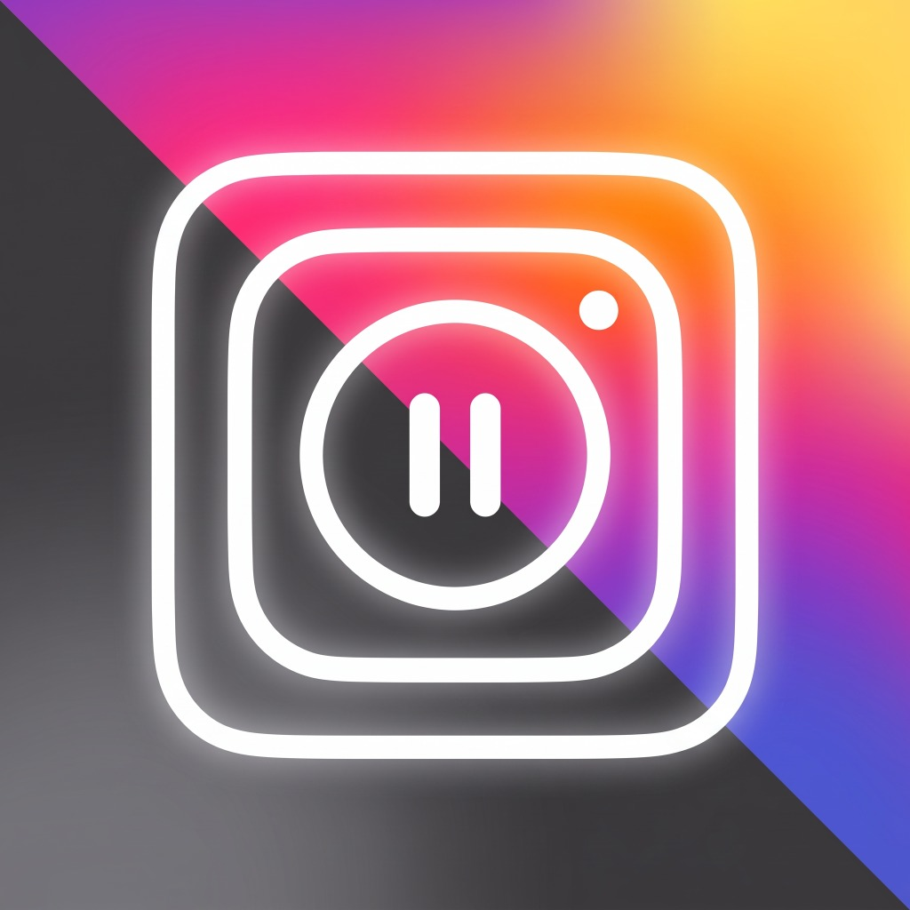

  

  # Unfeed (Stop Doom Scrolling)
  
  **Reclaim your attention. Experience Instagram without the infinite algorithmic feed, reels trap, or doomscrolling loops.**

  
  
  

   

  ### ⬇️ [Click Here to Download Latest APK (v1.0.0)](https://github.com/qaimhussain/UnFeed-Stop-Doom-Scrolling-/raw/main/release/Unfeed.apk)
  *Direct 1-click download of `Unfeed.apk` directly to your Android device.*

---

## 📱 App Screenshots

  <table>
    <tr>
      <td align="center" width="33%">
        <b>✨ Welcome Experience</b>  
        
      </td>
      <td align="center" width="33%">
        <b>🛡️ Anti-Doomscroll Engine</b>  
        
      </td>
      <td align="center" width="33%">
        <b>⚡ Intentional Messaging & Tools</b>  
        
      </td>
    </tr>
  </table>

---

## 💡 Why Unfeed?

Modern social media apps are engineered around infinite scrolling feedback loops that silently hijack hours of your day. **Unfeed** gives you back the utility of Instagram (DMs, Stories, Saved Collections, and Intentional Search) while neutralizing the addictive traps.

- 🚫 **Feed & Reels Blocked**: Infinite feed and autoplaying explore feeds are intercepted and blocked at the network and DOM layer.
- 💬 **Clean Direct Messaging**: Stay in touch with friends and family without getting sucked into algorithmic content.
- 📁 **Direct Saved Vault**: Jump straight into your curated bookmarks and saved post collections without browsing feeds.
- ⏳ **Custom Daily Limits**: Configurable time limits that gracefully lock the app when your daily budget is reached.
- 🎨 **Minimalist Aesthetics**: Designed with modern dark mode styling, subtle glassmorphism, and a distraction-free layout.

---

## 🚀 Quick Download & Install

1. Tap **[Download Unfeed.apk](https://github.com/qaimhussain/UnFeed-Stop-Doom-Scrolling-/raw/main/release/Unfeed.apk)** on your Android phone.
2. Open the downloaded `.apk` file from your notification bar or Downloads folder.
3. If prompted, allow *"Install from unknown sources"* for your browser or file manager.
4. Launch **Unfeed** and enjoy a calm, intentional experience!

> *Alternatively, view the release asset file in the repository: [`release/Unfeed.apk`](release/Unfeed.apk)*

---

## 🛠️ Built With

- **React Native & Expo SDK 54**
- **TypeScript**
- **React Native Reanimated & Gesture Handler**
- **React Native WebView** (Engineered with strict origin whitelisting & injection security)
- **Zustand & MMKV** for persistent local state

---

## 🔒 Privacy & Security

- **Direct Session**: Your authentication occurs directly via Instagram's official login endpoints inside a hardened WebView container.
- **Zero Third-Party Tracking**: Unfeed contains no external telemetry, tracking scripts, or ad networks.
- **Client-Side Enforced**: All focus timers, URL protections, and content blockers run locally on your device.

---

## 📄 License

This project is licensed under the MIT License - see the [LICENSE](LICENSE) file for details.
